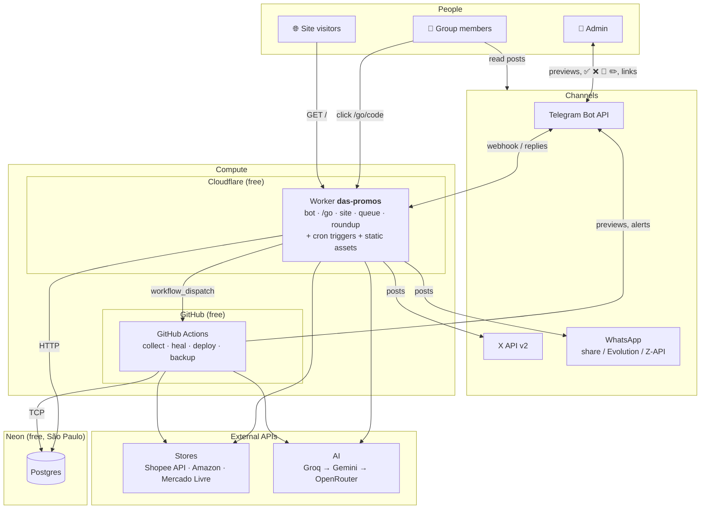
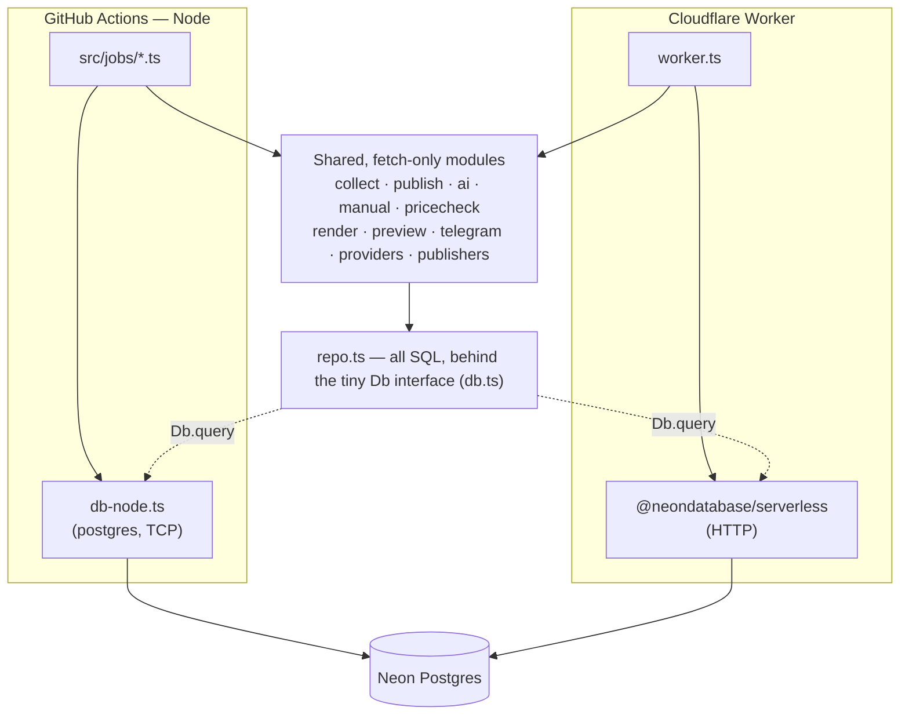
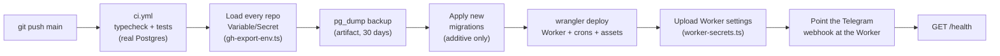
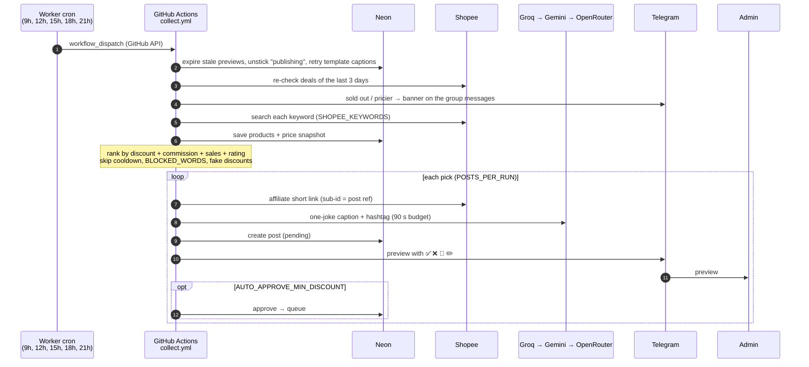
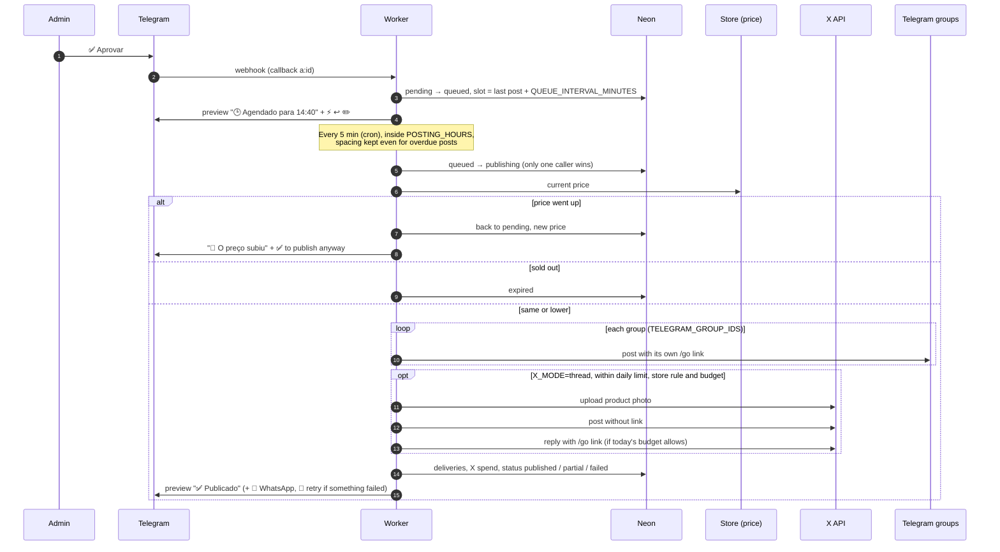
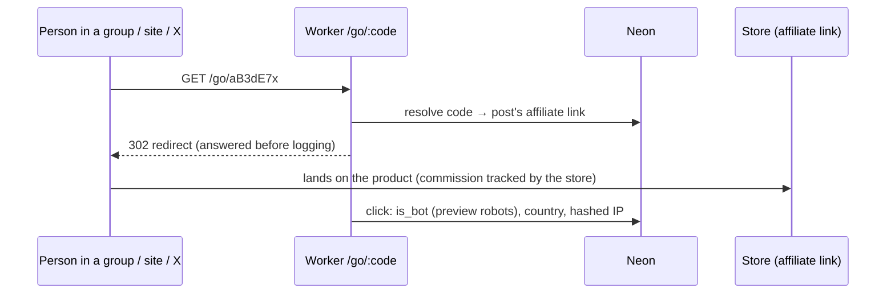
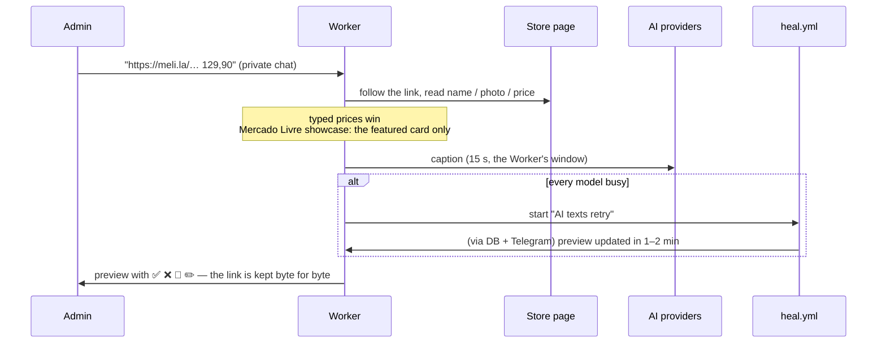
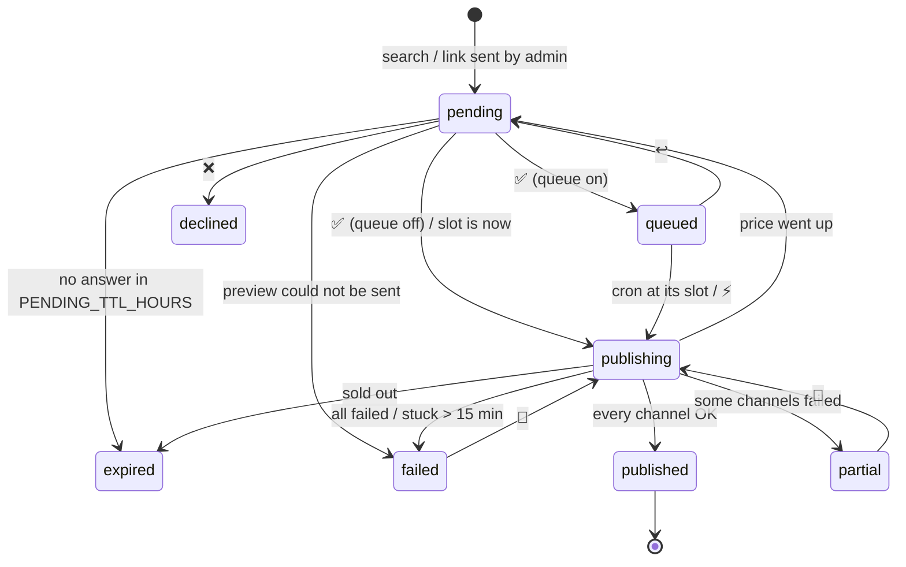
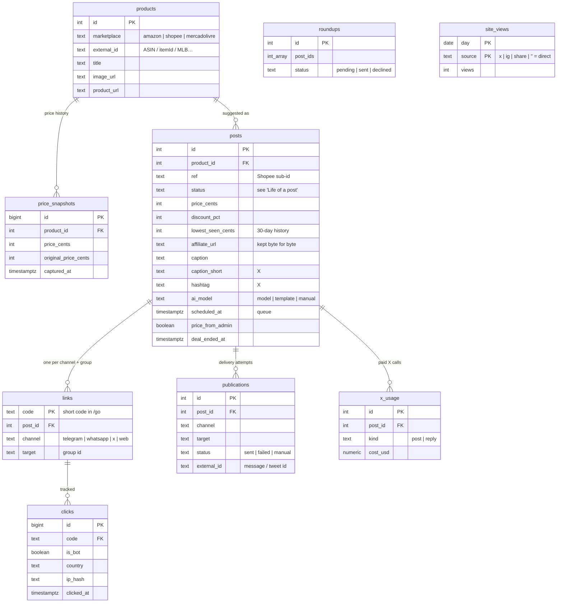

# Architecture

How **Dev das Promos** is put together: which service runs where, what each
part does, and how they talk to each other. Everything runs on free plans
except the optional pay-per-use X API.

- [1. The big picture](#1-the-big-picture)
- [2. Where each part runs](#2-where-each-part-runs)
- [3. Deploying](#3-deploying)
- [4. Main flows](#4-main-flows)
- [5. Life of a post](#5-life-of-a-post)
- [6. Data model](#6-data-model)
- [7. Reference](#7-reference)

## 1. The big picture

Three hosted services and a handful of external APIs:

**In one sentence:** GitHub Actions does the heavy, slow work (searching stores,
writing captions with time to spare), the Cloudflare Worker does everything that
must answer instantly or on a clock (the bot, tracked links, the public page, the
publishing queue), and Neon Postgres is the single source of truth both share.

## 2. Where each part runs

| Provider | Part | What it does | Code |
|---|---|---|---|
| **Cloudflare Workers** | Worker `das-promos` | Telegram webhook (buttons, commands, links sent by the admin), tracked redirects `/go`, WhatsApp/X share pages, public deals page, publishing to the channels | `src/worker.ts` → `src/http.ts` |
| | Cron triggers | Start the deal search, publish the queue, propose the weekly Top 10 | `wrangler.toml`, `scheduled()` in `src/http.ts` |
| | Static assets | Banner and link-preview image of the site | `public/` |
| **GitHub Actions** | `collect.yml` | Deal search: stores → ranking → AI caption → preview to the admin | `src/jobs/collect.ts` → `src/collect.ts` |
| | `heal.yml` | Rewrites captions that fell back to a template when the Worker ran out of time | `src/jobs/heal.ts` |
| | `deploy.yml` | Tests, backup, migrations, Worker deploy, Worker settings, Telegram webhook | see [Deploying](#3-deploying) |
| | `backup.yml` | Daily `pg_dump`, kept 90 days as an artifact | — |
| | `ai-check.yml` | Measures how often the AI writes the caption (manual) | `src/jobs/ai-check.ts` |
| | `ci.yml` | Typecheck + tests on pull requests (and inside `deploy.yml`) | `test/` |
| **Neon** | Postgres | Products, price history, posts, links, clicks, deliveries, roundups, X spend | `migrations/`, all SQL in `src/repo.ts` |
| **Shopee** | Affiliate Open API (GraphQL) | Offer search, affiliate short links (post ref as sub-id), price check by item | `src/providers/shopee.ts` |
| **Amazon** | Creators API · product pages | Search (needs an eligible account); pages read for links the admin sends and price checks | `src/providers/amazon.ts`, `src/manual.ts` |
| **Mercado Livre** | Product / showcase pages | `meli.la` affiliate links open the showcase; the featured card gives name, photo, price | `src/manual.ts` |
| **Groq · Gemini · OpenRouter** | Chat completions | One-joke captions + brand hashtag; tried in order, each with its own free quota | `src/ai.ts` |
| **Telegram** | Bot API | Previews and buttons for the admin, posts in the groups, banners on ended deals | `src/telegram.ts`, `src/bot.ts` |
| **X** | API v2 (pay-per-use) | Post without link + product photo, reply with the link, within the budget | `src/publishers/x.ts`, `src/publish.ts` |
| **WhatsApp** | Share link · Evolution · Z-API | One-tap share for the admin, or automatic sending through a gateway | `src/publishers/whatsapp.ts`, `src/share.ts` |
| **GitHub API** | `workflow_dispatch` | Lets the Worker (cron, `/buscar`, AI retry) start Actions workflows | `triggerCollect` in `src/bot.ts` |

**Two runtimes, one codebase.** The same TypeScript runs in both places (Node
22.18+ runs `.ts` directly, no build step). Code the Worker reaches must use only
`fetch` and WebCrypto, never `node:*` modules or the TCP database driver:

## 3. Deploying

A push to `main` runs `deploy.yml`. Each step stops the deploy if it fails.

Settings live only in GitHub (**Settings → Environments → production**); the
deploy hands the Worker the subset it needs (`WORKER_KEYS` in
`src/jobs/worker-secrets.ts`). A Worker setting changes only on the next deploy;
Actions jobs read settings fresh on every run.

## 4. Main flows

### 4.1 Deal search (5× a day)

GitHub's own scheduler runs late or skips runs, so a Worker cron starts the
search on time through the GitHub API.

### 4.2 Approval, queue and publishing

`⚡ Publicar agora` skips the wait; `↩️ Desagendar` puts the post back to a
preview; `🔁 Tentar de novo` re-sends only to the channels that failed.

### 4.3 Clicks

Every channel and group gets its own short code, so `/stats` can compare them.

### 4.4 Links the admin sends (Amazon, Mercado Livre)

### 4.5 Scheduled jobs

| When (Brasília) | Who | What |
|---|---|---|
| Every 5 min | Worker cron `*/5 * * * *` | Publish the next queued post whose time has come |
| 9h, 12h, 15h, 18h, 21h | Worker cron `7 0,12,15,18,21 * * *` | Start `collect.yml` (deal search) |
| Sundays 18h | Worker cron `0 21 * * SUN` | Weekly Top 10 preview for the admin |
| Daily ~3h | GitHub schedule (`backup.yml`) | `pg_dump` backup |
| On demand | Worker → `heal.yml` | Rewrite captions that fell back to a template |

Cloudflare numbers weekdays 1–7 or `SUN`–`SAT`; a rejected cron throws out every
schedule of the deploy, so `test/unit.test.ts` checks them.

## 5. Life of a post

Moving a post between states is always one SQL `UPDATE … WHERE status = <from>`
(`transition()` in `src/repo.ts`): if two taps or a tap and the cron race, only
one wins, so nothing is ever posted twice. Published deals can later get
`deal_ended_at` (sold out / pricier banner) without changing their status.

## 6. Data model

**Data safety:** migrations are append-only and never roll back; `DROP`,
`TRUNCATE` and `DELETE` are rejected by a test. Every deploy and every night
saves a `pg_dump`, and Neon can restore any point of the last hours. Money is
always integer cents.

## 7. Reference

### Worker routes

| Route | Purpose |
|---|---|
| `GET /`, `/ofertas` | Public page with the live deals of the last 7 days. `?src=x\|ig\|tt\|yt\|tg\|wa\|share\|google` (bio and share links) gives each source its own "web" links and visit count (`site_views`) |
| `GET /go/:code` | Tracked redirect to the affiliate link (`HEAD` doesn't count as a click) |
| `GET /wa/:code` | Opens WhatsApp with the post written |
| `GET /x/:code` | Page to copy the X post or open it in the X app (share mode) |
| `GET /wr/:id` | Opens WhatsApp with the weekly Top 10 written |
| `POST /telegram/webhook` | Bot updates (checked with `TELEGRAM_WEBHOOK_SECRET`) |
| `GET /robots.txt`, `/health` | Search engines; deploy smoke test |
| `/banner*.webp`, `/og.jpg` | Static assets from `public/` |

### Bot

| Command / button | Effect |
|---|---|
| `/pendentes`, `/fila` | Previews waiting; posts waiting for their slot |
| `/stats [dias]` | Clicks per channel, group and site source (`web x`…), site visits per source, store, best hours, top products, X spend |
| `/buscar` | Search now (starts `collect.yml`) |
| `/resumo` | Weekly Top 10 preview |
| `/id` | Chat id (for setting up groups) |
| Link in the private chat | Preview from an Amazon / Mercado Livre link |
| ✅ ❌ 🔄 ✏️ | Approve, decline, new AI text, write your own text |
| ⚡ ↩️ | Publish a queued post now; back to preview |
| 🔁 | Retry only the channels that failed |

### Source map

| File | Responsibility |
|---|---|
| `src/collect.ts` | Search run: ranking, cooldowns, fake-discount filter, auto-approve, healing |
| `src/publish.ts` | Approve / queue / publish, price check gate, X thread rules, ended deals |
| `src/bot.ts` | Telegram commands and buttons, links sent by the admin |
| `src/http.ts` | Worker routes and cron dispatch |
| `src/ai.ts` | Prompt, model fallback across providers, reply parsing |
| `src/manual.ts` | Reading store pages for links the admin sends |
| `src/pricecheck.ts` | Current price (Shopee API / store page) |
| `src/schedule.ts` | Queue slots and posting window |
| `src/render.ts`, `src/preview.ts` | Post text per channel; admin preview |
| `src/site.ts`, `src/roundup.ts`, `src/share.ts` | Public page, weekly Top 10, share links |
| `src/providers/*`, `src/publishers/*` | Store APIs; X / WhatsApp senders |
| `src/repo.ts` | All SQL |
| `src/config.ts` | Every setting (documented in `.env.example`) |
| `src/jobs/*` | Entry points for GitHub Actions and npm scripts |
