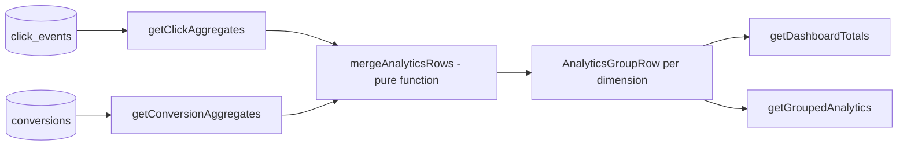

# Analytics

`packages/analytics` turns raw click and conversion events into the
numbers the admin dashboard and (eventually) the scoring pipeline itself
need -- click counts, conversion rate, and **measured** EPC (earnings per
click), broken down by channel, marketplace, category, deal, or date.

## Privacy-conscious click tracking

`GET /go/:code` (`apps/api/src/routes/go.ts`) is the only place a click is
recorded. Before anything is written, `buildClickTrackingRecord()`
(`packages/affiliate/src/click-tracking.ts`) transforms the raw request
into a privacy-safe shape:

- **IP is hashed, never stored.** `hashIp(ip, salt)`
  (`packages/shared/src/hash.ts`) is a salted SHA-256 hash, truncated --
  enough to deduplicate/rate-limit without retaining a reversible raw IP.
- **User-Agent is reduced to a coarse summary**, e.g. `"mobile:chrome"`,
  not the full UA string (which is close to a unique fingerprint per
  visitor). See `summarizeUserAgent()`.
- **The click insert is fire-and-forget** (`trackClickAsync()` in
  `apps/api/src/services/redirect.ts`) -- the redirect response to the
  user is never delayed waiting on an analytics write.

## Aggregation model



Clicks and conversions are aggregated **independently** by SQL
(`packages/analytics/src/click-aggregates.ts`,
`conversion-aggregates.ts`), each grouped by one `AnalyticsDimension`
(`"channel" | "marketplace" | "category" | "deal" | "date"`), then joined
in memory by `mergeAnalyticsRows()`
(`packages/analytics/src/merge.ts`) -- a pure, DB-independent function
kept separate specifically so the join/divide-by-zero logic (where these
bugs like to hide) is unit-tested without a database
(`packages/analytics/src/__tests__/merge.test.ts`).

```
conversionRate = conversions / clicks           (undefined if clicks = 0)
epcCents       = commissionCents / clicks        (undefined if clicks = 0)
```

This `epcCents` is the platform's **measured, real EPC** -- distinct from
`deal-engine`'s `estimatedEpc`, which is a heuristic projection made before
any clicks exist. Once a deal/category/channel has enough real click data,
`estimateHistoricalConversionRate()`
(`apps/api/src/services/conversion-signal.ts`) feeds the measured
conversion rate back into `scoreDeal()`'s `conversion` component on the
next evaluation -- this is the "architecture supports learning" loop: new
scores are informed by real outcomes, not just static heuristics. It
requires a minimum of 20 clicks before trusting the measured rate over the
3% heuristic default, to avoid noisy small-sample rates dominating the
score.

## Known limitation: conversions aren't channel-attributed

`conversions` are recorded against a `DealCandidate`, not against the
specific `Publication`/channel that drove the click (marketplace
postback data, when available, rarely carries that granularity back).
This means the `"channel"` dimension is accurate for **clicks** but the
conversion/revenue numbers on that same dimension are the deal's total
conversions, not necessarily attributable to that one channel. This is
documented directly in `conversion-aggregates.ts` and is the top item in
`docs/roadmap.md`'s attribution section.

## Dashboard totals

`getDashboardTotals()` (`packages/analytics/src/dashboard.ts`) is the
single query behind the admin dashboard's headline numbers: total/approved/
published deal counts, total clicks, conversions, revenue, commission, and
the platform-wide conversion rate and EPC -- the same
`mergeAnalyticsRows()` math applied with no dimension breakdown, just one
combined row.
