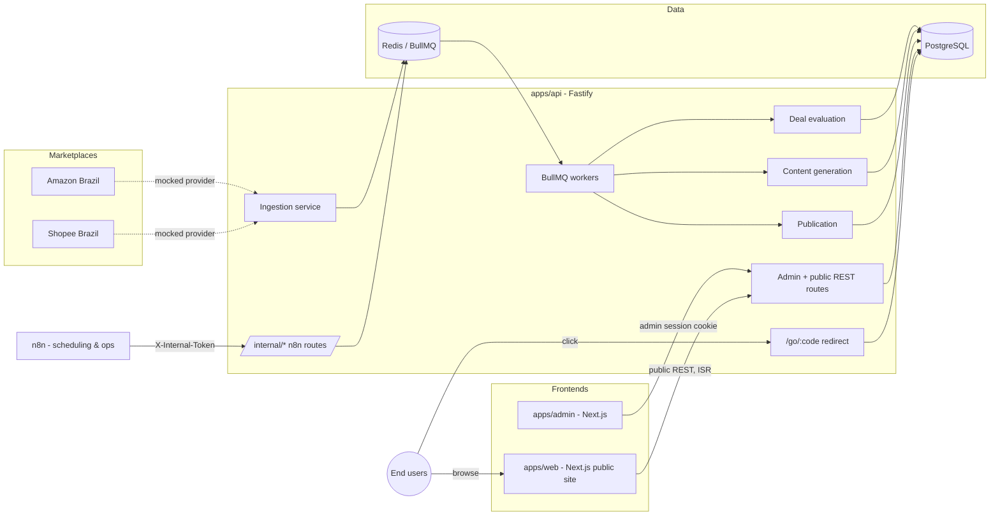
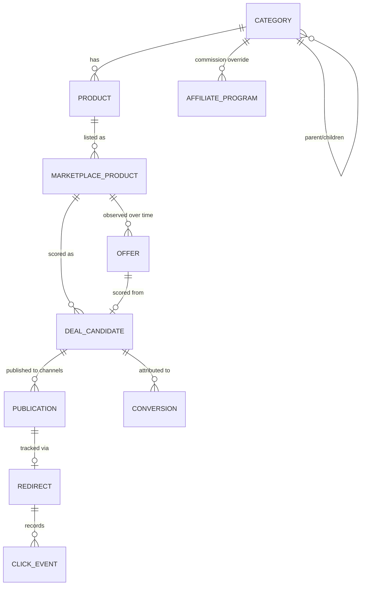
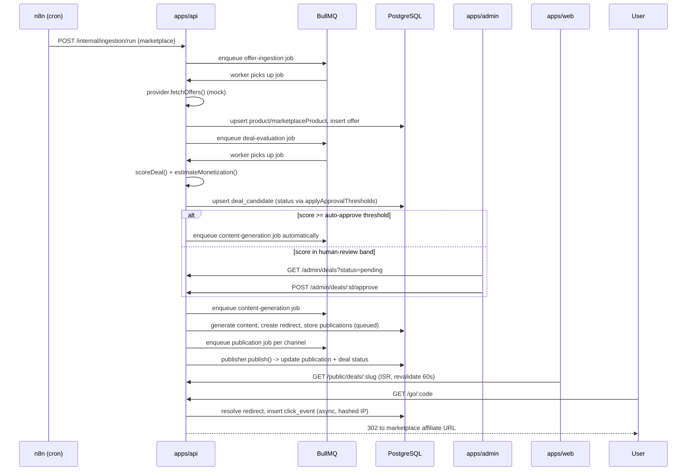

# Architecture

## System overview

das-promos is a TypeScript monorepo (pnpm workspaces + Turborepo) with
three deployable apps and nine framework-independent packages.



## Why a modular monolith, not microservices

`apps/api` runs the Fastify HTTP server **and** the BullMQ workers in the
same Node process (see `apps/api/src/server.ts`). For this platform's
scale (a handful of marketplaces, a moderate offer volume), splitting
ingestion/evaluation/content/publication into separate deployable services
would add operational overhead (more processes to deploy, monitor, and
version) without a corresponding benefit. The queue boundary
(`packages/queue`) is still there in the code, so extracting a queue's
worker into its own process later is a deployment change, not a rewrite --
just point a new process at `startWorkers()` and stop running workers
inline in the API process.

## Package structure

```
apps/
  api/      Fastify HTTP API + BullMQ workers (ingestion, scoring, content,
            publication, analytics), admin auth, /go/:code redirects
  admin/    Next.js admin dashboard (approve/reject/publish deals, browse
            products, view analytics) -- talks to apps/api with a session
            cookie
  web/      Next.js public site (SEO deal/product/category pages) -- talks
            to apps/api's /public/* routes with ISR caching

packages/
  config/          Validated env loading (zod) + scoring weights/thresholds
                    + disclosure copy. No dependency on any other package.
  shared/           Money (integer cents), slugs, hashing, shared zod enums,
                    Result<T,E>, password hashing.
  database/        Drizzle ORM schema, migrations, typed client, derived
                    price-history queries, seed data generators.
  deal-engine/     Pure, framework-independent scoring/discount/monetization/
                    approval logic. No DB, no HTTP -- fully unit tested.
  providers/        MarketplaceProvider abstraction + Amazon BR / Shopee BR
                    mock implementations + deterministic mock catalog.
  affiliate/       Commission resolution, redirect code generation/URL
                    building, privacy-conscious click-tracking helpers.
  content-engine/  Deterministic template-based deal copy generator +
                    Publisher abstraction (Telegram/X/Web + mocks).
  queue/           BullMQ queue names, job payload types, connection/queue
                    factories.
  analytics/       Click/conversion aggregation queries + pure merge logic.

infra/
  docker/          docker-compose.yml for Postgres + Redis only.
  n8n/             n8n workflow documentation (scheduling/ops layer).

docs/               This directory.
```

Dependency direction is strictly apps → packages, and within packages,
`deal-engine`/`affiliate`/`content-engine`/`providers` depend only on
`config` and `shared` -- never on `database` or an app. That's what keeps
`deal-engine` unit-testable with zero infrastructure.

## Domain model



Key modeling decisions:

- **Money is always integer cents** (`*Cents` columns), never floats --
  see `packages/shared/src/money.ts`. Formatting to BRL happens only at
  the display layer.
- **Price history is derived, not duplicated.** `offers` is an append-only
  observation log; `packages/database/src/price-history.ts` computes
  7d/30d/90d averages and minimums with a single SQL query using
  `FILTER (WHERE ...)` clauses, so there's nothing to keep in sync.
- **`deal_candidates` is upserted by slug**, one row per active
  product+marketplace pairing (see `evaluateOffer()` in
  `apps/api/src/services/deal-evaluation.ts`). Re-ingesting an offer
  re-scores the same DealCandidate rather than creating a new row, and a
  human decision (`reviewedBy` set) is preserved across re-evaluation
  unless explicitly re-run.
- **IDs are app-generated UUIDv4 text primary keys** (`crypto.randomUUID()`
  in `packages/database/src/schema/columns.ts`), not `gen_random_uuid()`,
  to avoid a Postgres extension dependency.

## Request flow: ingestion → public deal page



See [`docs/deal-engine.md`](./deal-engine.md) for the scoring formula,
[`docs/providers.md`](./providers.md) for the marketplace/publisher
abstraction, [`docs/analytics.md`](./analytics.md) for the click/conversion
model, and [`docs/n8n.md`](./n8n.md) for how the orchestration layer above
maps to n8n workflows.
