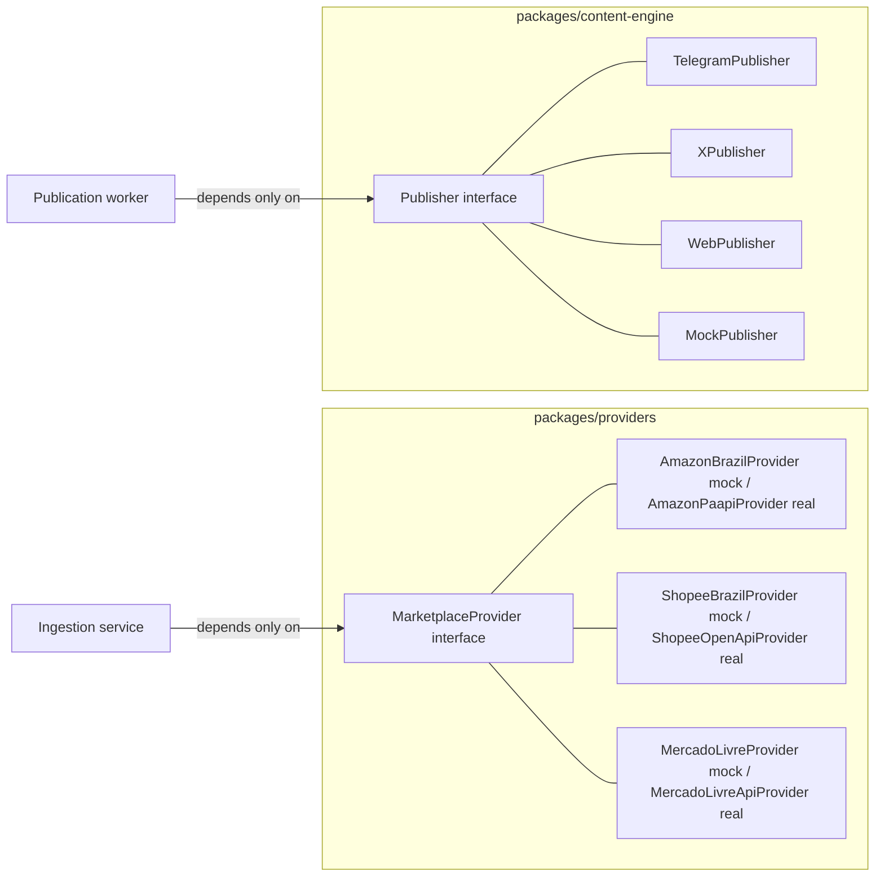

# Providers and publishers

Two symmetric abstraction points keep marketplace/channel-specific code out
of the core pipeline: **`MarketplaceProvider`** (how offers come in) and
**`Publisher`** (how content goes out).



Neither the ingestion pipeline nor the publication worker ever imports a
concrete provider or publisher class -- both go through a registry
(`createProviderRegistry()` / `createPublisherRegistry()`), so the mocks
used today and a real integration added later are interchangeable without
touching the pipeline code.

## MarketplaceProvider

```typescript
interface MarketplaceProvider {
  marketplace: Marketplace;
  fetchOffers(options?: FetchOffersOptions): Promise<MarketplaceOfferData[]>;
  getProduct(externalId: string): Promise<MarketplaceProductData | null>;
  buildAffiliateUrl(product: MarketplaceProductData, context?: AffiliateContext): Promise<string>;
}
```

(`packages/providers/src/types.ts`)

### What's implemented today

`AmazonBrazilProvider`, `ShopeeBrazilProvider`, and `MercadoLivreProvider`
(`packages/providers/src/amazon-br.ts`, `shopee-br.ts`, `mercado-livre.ts`)
are **deterministic mocks**: they generate realistic offers from a fixed
10-product catalog (`packages/providers/src/mock-catalog.ts` -- gaming
peripherals, a smartphone, pet products, an air fryer, a monitor, etc.)
using a seeded pseudo-random generator
(`packages/providers/src/deterministic-random.ts`, a mulberry32-style
PRNG), so re-running ingestion or the seed script produces the same demo
data every time.

Each marketplace also has a real, API-backed sibling class in the same
file (`AmazonPaapiProvider`, `ShopeeOpenApiProvider`,
`MercadoLivreApiProvider`), all implementing the same
`MarketplaceProvider` interface. A `create<X>Provider(credentials?)`
factory per marketplace (`createAmazonProvider`, `createShopeeProvider`,
`createMercadoLivreProvider`) returns the real implementation only when
its full real-mode credential set is present, and falls back to the mock
otherwise -- the same shape `createTelegramPublisher()` already
established in `packages/content-engine`. `createProviderRegistry()`
(`packages/providers/src/registry.ts`) is the only place these factories
are called; nothing else in the pipeline references a concrete class.
`packages/database/src/seed/marketplace-products.ts` (the demo-data
seeder) intentionally only ever passes the affiliate tag/id fields, never
the real-mode credentials, so `pnpm db:seed` stays on mock data even in a
fully-credentialed production environment.

**Do not scrape marketplace pages or call undocumented private APIs** --
that violates marketplace terms of service and is a legal/ToS risk this
platform does not take on; every real implementation below goes through
each marketplace's official, documented API.

### Amazon (Creators API)

`AmazonCreatorsApiProvider` talks to Amazon's **Creators API**, which
replaced the now-retired PA-API 5.0 (May 15, 2026). Auth is OAuth2
client-credentials (`POST https://api.amazon.com/auth/o2/token`), not
PA-API's hand-rolled AWS SigV4 -- the access token is cached in memory
and re-minted automatically shortly before it expires (documented
lifetime: 3600s). Product calls go to
`https://creatorsapi.amazon/catalog/v1/{searchItems,getItems}` with an
`x-marketplace` header, lowerCamelCase request/response fields, and the
full `offersV2` resource for price (`price.money.amount`, integer cents
via the shared `toCents()` helper)/availability
(`availability.type`, mapped directly onto this codebase's `Availability`
enum -- Creators API's enum values are cleaner than PA-API's free-text
message field ever was).

**Verified directly against Amazon's own Creators API docs**
(`affiliate-program.amazon.com/creatorsapi/docs/en-us/*`): the OAuth
token request, the `getItems` cURL example, the full `searchItems`
request/response shape, and the complete `offersV2` resource shape are
all taken verbatim from those pages. Two things are **inferred**, not
directly confirmed, and worth double-checking against a real account
before relying on them in production:
1. The Brazil `marketplace` string (`www.amazon.com.br`) -- the docs
   don't enumerate per-country values, this follows the documented
   `www.amazon.com` example pattern.
2. `getItems`' response envelope key (`itemsResult`) and the
   image/brand resource paths -- inferred from the documented
   PascalCase-to-lowerCamelCase migration rule, since only `searchItems`'
   full response shape was directly documented.

Old PA-API credentials (`AMAZON_PAAPI_ACCESS_KEY`/`_SECRET_KEY`) do
**not** work here -- register separately at
https://affiliate-program.amazon.com/creatorsapi for
`AMAZON_CREATORS_CLIENT_ID`/`AMAZON_CREATORS_CLIENT_SECRET`.

### Shopee (Affiliate Open API)

`ShopeeOpenApiProvider` talks to Shopee's Affiliate Open API (a GraphQL
endpoint, `https://open-api.affiliate.shopee.com.br/graphql`), signing
each request as `Authorization: SHA256 Credential=<AppId>,
Timestamp=<ts>, Signature=<sha256(AppId+Timestamp+Payload+Secret)>` via
`node:crypto`. Uses the `productOfferV2` query for search/single-item
lookups and the `generateShortLink` mutation for affiliate link
generation (forwarding `context.subId`/`context.campaign` as GraphQL
`subIds`). Retries on HTTP 429 / GraphQL rate-limit error code `10030`
with exponential backoff.

**Caveat worth knowing**: the exact endpoint/schema/signature format was
verified against a third-party-hosted mirror of Shopee's affiliate docs
(no direct API console access was available while building this), not
fetched from an authenticated developer-portal source. The shapes are
internally consistent and corroborated across independent sources, but
should be spot-checked against your own Shopee Partner/Affiliate
developer console before relying on it in production -- if Shopee has
since changed a field name or the signature recipe, this is the first
place to look.

## Mercado Livre

`MercadoLivreProvider` (`packages/providers/src/mercado-livre.ts`) is the
same kind of deterministic mock as the Amazon/Shopee ones above. A real,
API-backed sibling class -- `MercadoLivreApiProvider`, in the same file --
implements the same `MarketplaceProvider` interface against Mercado
Livre's official API (`https://api.mercadolibre.com`). A factory,
`createMercadoLivreProvider({ affiliateId?, appId?, clientSecret?,
refreshToken? })`, returns the real provider only when `appId`,
`clientSecret`, and `refreshToken` are all present, and falls back to the
mock otherwise -- the same credential-driven fallback shape as
`createTelegramPublisher()` in `packages/content-engine`.

### Authentication: OAuth2 with a one-time manual step

Mercado Livre uses OAuth2. Access tokens are short-lived (~6h,
`expires_in` in the token response) and must be refreshed with a
`refresh_token` grant. **Obtaining the very first refresh token requires
a human to complete an authorization-code exchange in a browser once** --
there is no way to automate that first step, and no full consent-flow UI
is built here. After that one-time setup, `MercadoLivreApiProvider`
refreshes access tokens automatically and needs no further manual
intervention (with one caveat on rotation -- see below).

**One-time setup:**

1. **Create a Mercado Livre application** at the DevCenter
   (https://developers.mercadolivre.com.br/devcenter, or directly at
   https://developers.mercadolivre.com.br/devcenter/new-list-app -- log
   in with the account that has the approved affiliate/associate
   program), registering a redirect URI you control (it must match
   exactly on every call). **Mercado Livre requires this URI to use
   HTTPS -- plain `http://` is rejected, including
   `http://localhost:PORT/callback`.** For a throwaway URL you can read
   the query string of without running any real server, use a tunnel
   tool like `ngrok http 8080`, which prints a free
   `https://xxxx.ngrok-free.app` URL to use as the redirect (see
   `docs/aws-deployment.md` Part 1.2 for the full walkthrough). This
   gives you an `APP_ID` (client id) and a `CLIENT_SECRET`.

2. **Visit the authorization URL once, in a browser, logged into the ML
   account that owns the affiliate program**:

   ```
   https://auth.mercadolivre.com.br/authorization?response_type=code&client_id=$APP_ID&redirect_uri=$REDIRECT_URI
   ```

   After granting access you'll be redirected to `$REDIRECT_URI?code=TG-...`
   -- copy the `code` query param (it's single-use and short-lived).

3. **Exchange that code for the first access + refresh token**:

   ```bash
   curl -X POST https://api.mercadolibre.com/oauth/token \
     -H 'accept: application/json' \
     -H 'content-type: application/x-www-form-urlencoded' \
     -d 'grant_type=authorization_code' \
     -d "client_id=$APP_ID" \
     -d "client_secret=$CLIENT_SECRET" \
     -d "code=$AUTH_CODE" \
     -d "redirect_uri=$REDIRECT_URI"
   ```

   The JSON response includes `access_token`, `expires_in` (seconds,
   typically 21600), and -- the one you actually need to keep -- a
   `refresh_token`.

4. **Set the three env vars** (`packages/config/src/env.ts` already
   validates them as optional strings; `.env.example` already lists them):

   ```
   MERCADO_LIVRE_APP_ID=<client id from step 1>
   MERCADO_LIVRE_CLIENT_SECRET=<client secret from step 1>
   MERCADO_LIVRE_REFRESH_TOKEN=<refresh_token from step 3>
   MERCADO_LIVRE_AFFILIATE_ID=<optional, forwarded to the mock provider>
   ```

   With all three of the first vars set, the provider registry (wired
   centrally, see below) picks `MercadoLivreApiProvider`; with any missing,
   it falls back to the mock, so local dev/CI never need real credentials.

**Refresh-token rotation caveat**: Mercado Livre rotates refresh tokens --
every `grant_type=refresh_token` exchange returns a *new* refresh token
and immediately invalidates the old one, and an unused refresh token
expires after ~6 months. `MercadoLivreApiProvider` caches the rotated
token in memory and keeps using it for the life of the process, and logs
a warning containing the new value so an operator can update
`MERCADO_LIVRE_REFRESH_TOKEN` before the *next* restart -- there's no way
for the provider to rewrite the environment/secret store itself. If the
refresh token is ever invalid/expired/revoked, every call fails with a
clear, distinct error message telling you the manual authorization-code
flow (steps 1-3 above) must be repeated -- this is unrecoverable
automatically, by design of Mercado Livre's OAuth flow.

### API endpoints used

- **Search**: `GET https://api.mercadolibre.com/sites/MLB/search?q=&category=&limit=&offset=`
  (site id `MLB` = Mercado Livre Brasil).
- **Single item**: `GET https://api.mercadolibre.com/items/{item_id}`.
- **Seller reputation** (mapped onto `sellerRating`, 0-100): `GET
  https://api.mercadolibre.com/users/{seller_id}` ->
  `seller_reputation.level_id` (`"5_green"` down to `"1_red"`, or absent).
  When there's no reputation history to map, `sellerRating` is omitted
  rather than fabricated, per the same convention Shopee's mock/real split
  follows for fields with no clean equivalent.

### Affiliate links: no official programmatic API exists

Unlike Amazon (Creators API) and Shopee (Open Platform), **Mercado Livre does
not currently expose a documented, public API for generating affiliate
links.** Its "Programa de Afiliados" (relaunched 2023) only issues
tracked short links (`mercadolivre.com.br/sec/...`) through a web portal
(`https://www.mercadolivre.com.br/afiliados-home`), one product at a
time, by a logged-in human -- confirmed against current developer-portal
and affiliate-program documentation while building this integration.
There is also no verified, currently-working query-parameter scheme for
building one client-side: the mock provider's `matt_word`/`matt_tool`
params are a historical, best-effort guess this research could not
confirm still works, so `MercadoLivreApiProvider.buildAffiliateUrl()`
deliberately **throws** a clear error instead of emitting an
untracked/broken link. A real deployment needs a separate,
manually-maintained lookup (e.g. a table mapping `externalId` to a
portal-generated short link) wired in ahead of calling this method for
Mercado Livre products.

### Adding a new marketplace provider

1. Create `packages/providers/src/<marketplace>.ts` implementing
   `MarketplaceProvider`.
2. Add the marketplace to the `Marketplace` union
   (`packages/shared/src/types.ts`) and to `marketplaceEnum`
   (`packages/database/src/schema/enums.ts` -- requires a migration).
3. Register it in `createProviderRegistry()`
   (`packages/providers/src/registry.ts`).
4. Add default affiliate program(s) for it in
   `packages/database/src/seed/affiliate-programs.ts` if you want seed data
   to exercise it.

No other file needs to change -- the ingestion service
(`apps/api/src/services/ingestion.ts`) and the admin re-fetch action call
`getProvider(marketplace)` and never reference a concrete class.

## Publisher

```typescript
interface Publisher {
  channel: PublicationChannel;
  publish(payload: PublicationPayload): Promise<PublicationResult>;
}
```

(`packages/content-engine/src/types.ts`)

### What's implemented today

- **`MockPublisher`** -- always "succeeds" without calling anything
  external. Used automatically whenever real credentials aren't
  configured, so local dev and CI never require live bot tokens.
- **`TelegramPublisher`** -- a real implementation that calls the Telegram
  Bot API's `sendMessage` endpoint. `createTelegramPublisher()`
  (`packages/content-engine/src/publishers/telegram-publisher.ts`) falls
  back to `MockPublisher` when `TELEGRAM_BOT_TOKEN`/`TELEGRAM_CHAT_ID`
  aren't set, so startup never fails on missing credentials.
- **`XPublisher`** -- a real implementation that signs each request with
  OAuth 1.0a user-context auth (HMAC-SHA1 via `node:crypto`, no OAuth1
  library dependency) and posts to `POST https://api.x.com/2/tweets`.
  `createXPublisher()` falls back to `MockPublisher` when
  `X_API_KEY`/`X_API_SECRET`/`X_ACCESS_TOKEN`/`X_ACCESS_TOKEN_SECRET`
  aren't all set. Content is defensively truncated to X's character limit
  (`DEFAULT_CONTENT_LIMITS.x` in `packages/content-engine/src/limits.ts`)
  before posting, on top of the caller already respecting that limit when
  generating content.
- **`WebPublisher`** -- a no-op success; "publishing" to the public site
  channel just means the DealCandidate becomes visible through
  `/public/deals`, there's no external call to make.

### Content generation stays separate from publishing

`ContentGenerator` (`packages/content-engine/src/types.ts`) is a
**different** interface from `Publisher` -- it turns a fully-supplied
`DealContentInput` into per-channel text; `Publisher` just ships already-
generated text to a channel. This split means the content generator and
the publisher can be swapped independently without touching each other.

Two `ContentGenerator` implementations exist:

- **`TemplateContentGenerator`** (`packages/content-engine/src/template-generator.ts`)
  -- the default, always-available, fully deterministic implementation.
  Uses string templates (`packages/content-engine/src/templates/{telegram,x,web}.ts`)
  with the appropriate `#publi`/`#ad` disclosure always appended
  (`packages/config/src/disclosure.ts`). Never invents facts or enriches
  the input -- everything it prints was passed in by the caller. No
  network call, no API key, no cost.
- **`OpenRouterContentGenerator`** (`packages/content-engine/src/openrouter-generator.ts`)
  -- an AI-backed alternative using [OpenRouter](https://openrouter.ai), a
  single API that proxies many models, several of them free. Restates
  `DealContentInput`'s fields as a plain-text fact sheet and instructs the
  model (system prompt, not user-editable) to use *only* those facts --
  no inventing prices, stock levels, or urgency claims -- and to respond
  with a JSON object of the three channel fields. The disclosure text and
  X's character limit are then enforced **deterministically** after the
  model responds (never trusted to the model), exactly like the plain
  templates. `createOpenRouterContentGenerator({ apiKey, model })` falls
  back to `TemplateContentGenerator` when either is absent, and
  `apps/api/src/services/content-generation.ts` also falls back to it for
  a single deal if the OpenRouter call throws for any reason (network
  error, rate limit, malformed response) -- a flaky AI call never blocks
  the pipeline.

**Env vars**: `OPENROUTER_API_KEY` and `OPENROUTER_MODEL` (both required
to activate the real generator; see `.env.example`). `OPENROUTER_MODEL`
has no hardcoded default anywhere in this codebase on purpose --
OpenRouter's free-model catalog (models with a `:free` suffix) rotates
over time, so pick a current one from
https://openrouter.ai/models?max_price=0 rather than relying on a default
that could go stale.

**Daily quota, to stay on the free tier**: `AI_CONTENT_DAILY_LIMIT`
(default 10) caps how many deals get AI-generated content per UTC day --
comfortably under OpenRouter's free-tier request cap (50/day on a fresh
account, 1000/day after any credit purchase; each deal makes up to 3
OpenRouter calls, one per channel, since each channel embeds its own
`/go/:code` redirect link). The counter is Redis-backed
(`apps/api/src/lib/ai-content-quota.ts`, key `ai-content:daily-count:<UTC
date>`) so it survives process restarts, and is checked **once per deal**
(not once per channel) in `generateContentForDeal` -- reusing whichever
generator was picked across that deal's telegram/x/web calls, so one deal
never costs 3x its fair share of the daily budget. Once the quota is
spent for the day, remaining deals silently get template content instead
-- nothing fails, the platform just stops spending AI calls until the UTC
day rolls over.

### Adding a new publication channel

1. Add the channel to the `PublicationChannel` union
   (`packages/shared/src/types.ts`) and `publicationChannelEnum`
   (`packages/database/src/schema/enums.ts` -- requires a migration).
2. Add a template function in `packages/content-engine/src/templates/`
   and wire it into `TemplateContentGenerator.generateDealContent()`.
3. Implement `Publisher` in `packages/content-engine/src/publishers/`
   (with a credential-driven mock fallback, following the Telegram
   pattern).
4. Register it in `createPublisherRegistry()`
   (`packages/content-engine/src/publishers/registry.ts`).
5. Add the channel's disclosure copy to `DISCLOSURE_TEXT`
   (`packages/config/src/disclosure.ts`).

The publication worker (`apps/api/src/workers/publication.worker.ts`) and
`publishDealToChannel()` (`apps/api/src/services/publication.ts`) call
`getPublisher(channel)` and never reference a concrete class, same as the
provider side.
