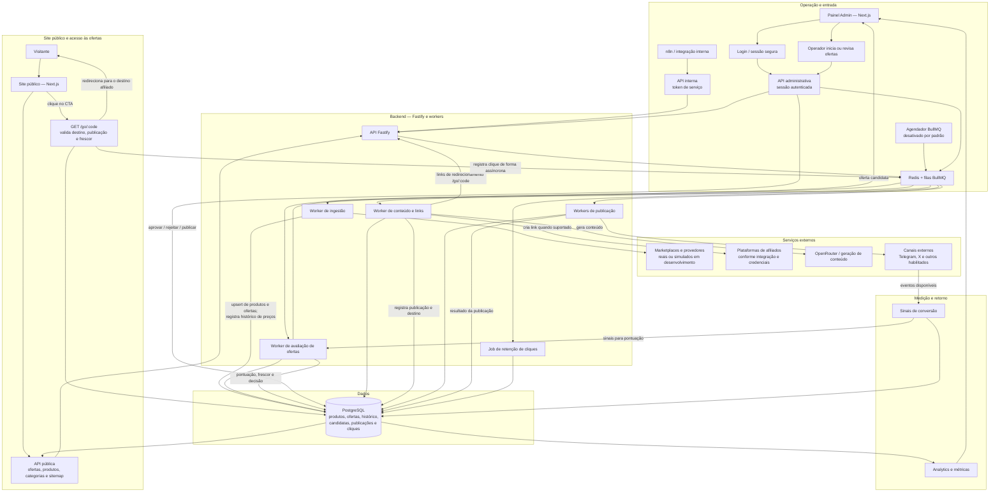

# Fluxo completo do sistema

Este documento descreve os principais caminhos de operação do Das Promos: ingestão e avaliação de ofertas, aprovação e publicação, navegação pública, redirecionamento de afiliados e medição de resultados.

### Notas de operação

- O agendador fica desativado por padrão e deve ser habilitado explicitamente no ambiente.
- Provedores simulados servem para desenvolvimento; produção deve usar integrações reais.
- A publicação em cada canal e a geração de links afiliados dependem das integrações e credenciais configuradas.
- A API valida o código, o destino e o estado da oferta antes de redirecionar o visitante.
- Eventos de clique alimentam métricas; sinais de conversão disponíveis podem retornar à avaliação das ofertas.
